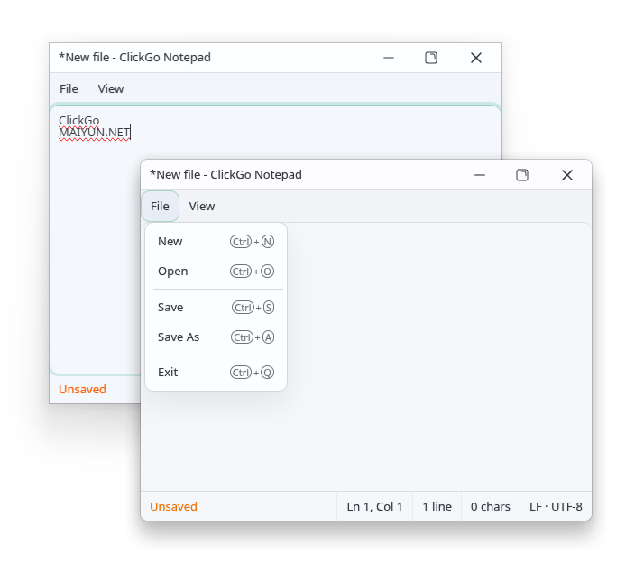

# ClickGo Notepad
A lightweight text editor for web and desktop, primarily showcasing the ClickGo framework series.

<p align="center"></p>

You need to install [ClickGo Compiler](https://github.com/maiyun/clickgo-compiler) globally first.

```sh
npm install -g clickgo-compiler
```

## Run

Install dependencies with `npm install`, then run `npm run build` to compile TypeScript and generate `dist/app.cga`.

Run `clickgo --run ./dist/index` to start the app.

## Build

Run `clickgo --native` to build the app.

### CN Mirror

Run `clickgo --native --mirror cn`.

On macOS, run `clickgo --native --platform mac --mirror cn` to build DMG and ZIP packages for x64 and arm64. The existing PNG supplies the application icon. Release auto-updates require a signed application; supply signing credentials through the build environment and publish the generated ZIP, `latest-mac.yml` and matching release files together.

## Opening files

In desktop builds, opening a local text-based file such as `.txt` or `.json` through the system, opening another file while Notepad is already running, and dropping a file onto the window all open the file in the existing editor. The file picker also provides an **All Files** option for source code and other plain-text formats. Replacing an edited document always asks whether to save, discard, or cancel. **Save As** uses `Ctrl+Shift+S`; `Ctrl+A` remains available for selecting all text.

## Update checks

Installed desktop builds check for new versions at startup. Select **View → Check for Updates** (`Ctrl+U`) to check manually. When an update is available, choose **Download**, then **Restart and Install**. Unsaved documents must be saved before installation. Choose **Later** to continue working; check again to install an already downloaded update. Updates are disabled in web, development, and Windows portable builds.

Configure the update source using `build.publish` in [package.json](./package.json). Update metadata examples for each platform are in [yml/](./yml/README.md). For release setup and publishing instructions, see the [electron-updater guide](https://www.electron.build/v26/docs/features/auto-update/).

## AI access

Open **View → AI Access** and copy the guide to your AI client to read, edit, open and save documents. Web supports JavaScript and WebMCP where available; desktop also supports HTTP MCP, stdio and CLI, with automatic startup when needed. The client discovers commands and their parameters after connecting.

For HTTP, select **Show HTTP connection settings**. Keep the token private and obtain fresh settings after restarting. Desktop clients use Notepad's executable without installing Node.js.

## Description
This project is a demonstration of how to use *ClickGo Native* to compile *ClickGo* projects for *macOS*, *Windows*, and *Linux*. Please note: the project itself is not a production-ready application and serves no practical purpose beyond showcasing the build process.

## License
This project is published under [AGPL-3.0](./LICENSE) license.
